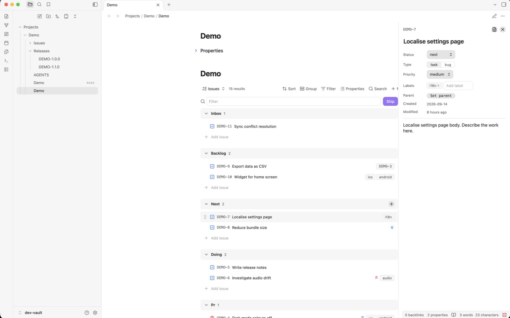

# Issues

A sectioned issue list for [Obsidian](https://obsidian.md), built as a custom [Bases](https://help.obsidian.md/bases) view.

Every issue is a Markdown note. Its frontmatter holds the data, a project note holds the configuration, and a `.base` file gathers them into a list that looks and behaves like a lightweight Linear: statuses as sections, drag to reorder, a detail panel, releases with a one-click ship. Nothing lives outside the vault, so the notes stay useful without the plugin, and agents or scripts can create and move issues by editing files.

Runs on desktop and mobile. Requires Obsidian 1.14 or later with the Bases core plugin enabled.



## Contents

- [What you get](#what-you-get)
- [Install](#install)
- [Set up a project](#set-up-a-project)
- [Issues as notes](#issues-as-notes)
- [Working with the list](#working-with-the-list)
- [Releases](#releases)
- [Project configuration](#project-configuration)
- [Writing issues without the plugin](#writing-issues-without-the-plugin)
- [Development](#development)
- [Documentation](#documentation)

## What you get

- **One list per project.** Sections follow the project's statuses: active work from the last stage down to the inbox, then the closed statuses at the end. Each row shows a type icon, the key, the title, a priority icon and label chips.
- **Manual ordering.** Drag a row within a section to rank it, or into another section to change its status. The position is stored on the note, so it survives reloads and syncs with the vault.
- **Row menu.** Send to top, Send to bottom, Move to any status. Right-click on desktop, hold and release on mobile.
- **Detail panel.** Click a row: title, status, type, priority, labels, parent and release are editable in place; the note body renders below. Open the note itself with one click.
- **Quick add.** An add row at the bottom of every section and a plus button in each header. Type a title, press Enter.
- **Releases.** A release is a note. Ship moves every merged issue into it and stamps the release date. The released section groups by release, and each group can copy a changelog.
- **Closed work gets out of the way.** Closed issues hide after a configurable number of days without being deleted.
- **A text filter** in the toolbar, and Bases' own filters for saved views.
- **A contract for agents.** The plugin writes an `AGENTS.md` into each project folder describing exactly how to create and move issues by editing files.

## Install

The plugin is not in the community catalogue. Install it by hand:

1. Download `main.js`, `manifest.json` and `styles.css` from the latest [release](https://github.com/maxhuk/issues-obsidian/releases), or build them (see [Development](#development)).
2. Copy the three files into `<your vault>/.obsidian/plugins/issues/`.
3. In Obsidian, open **Settings → Community plugins**, turn off Restricted mode if needed, and enable **Issues**.
4. Make sure the **Bases** core plugin is enabled.

Obsidian Sync carries the plugin folder to your other devices like any other vault content.

## Set up a project

A project is a folder with a project note and a base. The example below uses a project called Breathe with the key `BRE`.

**1. Create the folder and the project note.**

`Projects/Breathe/Breathe.md`:

```markdown
---
type: project
project: BRE
---
# Breathe

![[Breathe.base]]
```

`type: project` is what makes the note a project. `project` is the key: it prefixes every issue (`BRE-1`, `BRE-2`, …) and is the value every issue and release carries in its own `project` property.

**2. Create the base.**

`Projects/Breathe/Breathe.base`:

```yaml
filters:
  and:
    - 'project == "BRE"'
views:
  - type: issues-list
    name: Issues
```

The filter selects everything carrying the project key: the project note, the issues and the releases. The view type `issues-list` is this plugin.

**3. Open the project note.**

The embedded base renders the list with every section empty. Add your first issue with the add row under any section. The plugin creates `Projects/Breathe/Issues/BRE-1.md`.

That is the whole setup. The folder now looks like this:

```
Projects/Breathe/
  Breathe.md          project note, embeds the base
  Breathe.base        the list
  AGENTS.md           written by the plugin: how to edit issues as files
  Issues/
    BRE-1.md
    Attachments/      where Obsidian puts pasted images
  Releases/
    BRE-1.0.0.md      created the first time you ship
```

### Several views on one base

Add more views to the base with Bases filters to get narrower lists with the same behaviour. For example, only the `ops`-labelled work:

```yaml
views:
  - type: issues-list
    name: Issues
  - type: issues-list
    name: Ops
    filters:
      and:
        - 'labels.contains("ops")'
```

Switch between them with the view menu in the Bases toolbar. The base's own sort and group settings are ignored by this view type; sections are always statuses and rows are always in manual order.

## Issues as notes

An issue is a note in the issues folder named after its key. This is what the plugin writes when you add one:

```markdown
---
title: Fix timer drift on iOS
project: BRE
type: task
status: backlog
priority: medium
labels: []
created: 2026-10-10
order: a0
---
```

| Property | Values | Notes |
|---|---|---|
| `title` | text | Shown in the row. |
| `project` | the project key | How the base finds it. |
| `type` | `task`, `bug` | Blue checked square or red bug icon. |
| `status` | one of the project's statuses | The section. |
| `priority` | `high`, `medium`, `low` | Icon only when not `medium`. |
| `labels` | list | Chips on the row. |
| `parent` | `"[[BRE-100]]"` | Optional. Shown as a chip that opens the parent. |
| `release` | `"[[BRE-1.5.0]]"` | Set when the issue is released. |
| `order` | opaque key | Position within the section. Owned by the plugin. |
| `created` | `YYYY-MM-DD` | |
| `closed` | `YYYY-MM-DD` | Present only in a closed status. |

The body is yours: description, acceptance criteria, pasted screenshots, progress notes. The panel renders it read-only; edit it in the note.

## Working with the list

**Sections.** One per status: open statuses from the last stage down to the first, then the closed ones, each with a count, a collapse chevron and an add button. Collapsed state is saved in the base, so it is the same on every device. Statuses found on issues but missing from the configuration get their own section at the end, so nothing is ever hidden by a typo.

**Reordering.** On desktop, drag a row. On a phone, hold a row for a moment to lift it, then drag. Dropping in another section changes the status. The drop writes a new `order` to the moved note and nothing else, except when neighbouring rows have no order yet; then the plugin keys that section first.

**Row menu.** Right-click a row, or on a phone hold and release without moving:

- Send to top / Send to bottom
- Move to `<status>`, one entry per status

**Detail panel.** Click a row. On desktop the panel opens as a drawer at the right edge of the pane, beside the note's text column; on a phone it fills the screen. Status, type, priority, labels, parent and release are controls that write immediately. Created and Modified dates come from the property and the file. The copy icon next to the key copies it, for commit messages.

**Adding.** Press the plus in a section header to add at the top, or use the "Add issue" row to add at the bottom. Enter creates, Shift+Enter creates and keeps the input open, Escape closes it.

**Filtering.** The toolbar's filter box narrows rows by title, key or label as you type. It never reveals hidden or collapsed rows.

**Closed sections.** Issues in a closed status (by default `released` and `canceled`) hide after 14 days. The header shows how many are hidden and a toggle to show them.

## Releases

Releases are on by default and give you a `pr → merged → released` tail on the status flow.

**A release is a note** in the releases folder, named with the key and the version:

```markdown
---
type: release
project: BRE
version: 1.5.0
status: planned
---
```

**Shipping.** When at least one issue is in `merged`, the toolbar shows **Ship**. It asks which planned release to ship, or lets you type a new version, then:

1. marks the release note `released` with today's date,
2. moves every `merged` issue to `released`, linking it to the release and stamping `closed`.

**The released section** groups issues by release: planned releases first, then shipped ones newest first. Each group header has a copy button that puts a changelog on the clipboard:

```
- Add onboarding screen
- Localise settings page
Fixes
- Crash on cold start
```

**Moving a single issue** into `released`, by drag or menu, asks for a release too, so a hotfix can be recorded without shipping everything in `merged`.

**Projects without releases.** Set `releases: false` on the project note. The default statuses become `inbox, backlog, next, doing, done, canceled`, and everything about releases disappears from the list.

## Project configuration

All configuration is frontmatter on the project note. Only `type` and `project` are required.

```markdown
---
type: project
project: BRE
releases: true
statuses: [inbox, backlog, next, doing, pr, merged, released, canceled]
statuses_closed: [released, canceled]
status_released: released
status_ship_from: merged
hide_closed_after_days: 14
issues_folder: Issues
releases_folder: Releases
issue_template: Templates/Issue.md
---
```

| Property | Default | Meaning |
|---|---|---|
| `releases` | `true` | Track releases. |
| `statuses` | see above; without releases `[inbox, backlog, next, doing, done, canceled]` | Section vocabulary, first stage to last; the list shows open statuses in reverse, then closed ones. Lowercase words. |
| `statuses_closed` | `[released, canceled]`; without releases `[done, canceled]` | Statuses that end an issue's life. |
| `status_released` | `released` | The status tied to a release. Must be in `statuses_closed`. |
| `status_ship_from` | `merged` | What Ship sweeps. |
| `hide_closed_after_days` | `14` | Days before a closed issue hides. `0` hides all closed issues. The released section is exempt. |
| `issues_folder` | `Issues` | Relative to the project note's folder. Created on first use. |
| `releases_folder` | `Releases` | Relative to the project note's folder. |
| `issue_template` | none | Vault path of a note whose body seeds every new issue. |

Example of a smaller vocabulary for a side project:

```yaml
type: project
project: BLOG
releases: false
statuses: [idea, writing, published, dropped]
statuses_closed: [published, dropped]
hide_closed_after_days: 30
```

A configuration mistake, such as a closed status that is not in `statuses`, replaces the list with a message naming the property.

## Writing issues without the plugin

Agents, scripts and people in a plain text editor can create and move issues by writing files. The rules are short, and the plugin writes them into every project folder as `AGENTS.md`, filled in with that project's key, folders and statuses. The file is regenerated whenever the configuration or the plugin changes.

The essentials:

- The next key is the highest existing number plus one.
- Write `title`, `project`, `type`, `status`, `priority`, `labels`, `created`. Never write `order`; a note without it sorts last in its section.
- Entering a closed status sets `closed`; leaving one removes it. Entering the released status also sets `release`.
- Quote wikilinks: `parent: "[[BRE-100]]"`.

## Development

```bash
npm install
npm run dev          # watch build into dev-vault/.obsidian/plugins/issues/
npm test             # unit tests over src/model
npm run lint
npm run build        # type-check and produce main.js
```

`dev-vault/` is a small vault with a Demo project: open it in Obsidian, enable the plugin, and reload after each change. To install into your own vault:

```bash
cp install.config.example.json install.config.json   # set vaultPath
npm run install:vault
```

The code splits into a pure model (`src/model`, tested), vault adapters (`src/vault`) and the view (`src/view`). The model never imports Obsidian; it turns user actions into plans that the vault layer applies. [docs/architecture.md](docs/architecture.md) has the full map.

## Documentation

- [docs/spec.md](docs/spec.md): the complete behaviour, the source of truth for what the plugin does.
- [docs/architecture.md](docs/architecture.md): module layout, the Bases contract, data flow, testing and documentation rules.
- [CHANGELOG.md](CHANGELOG.md): what changed in each version.

## License

[MIT](LICENSE)
